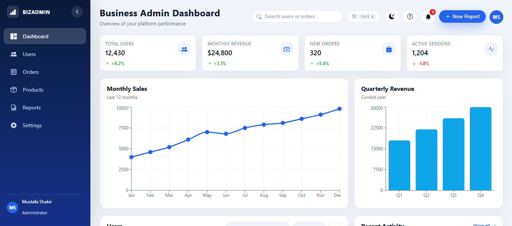
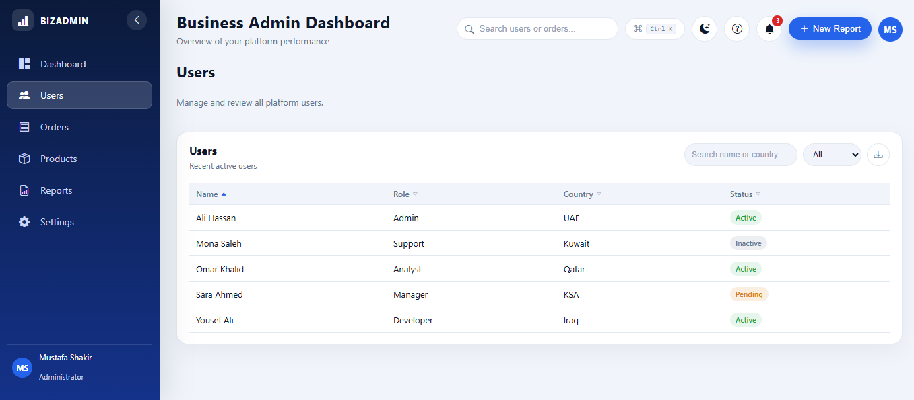
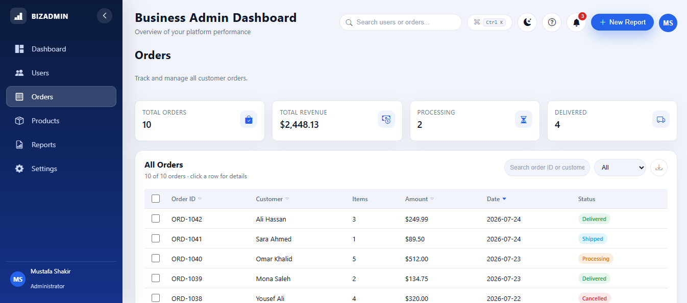
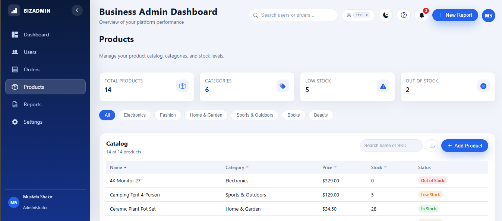
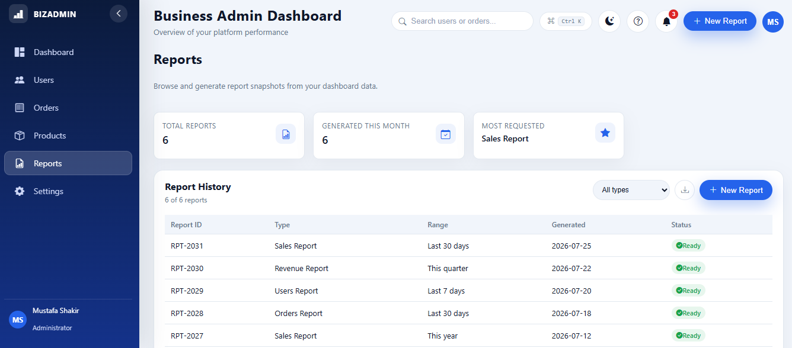
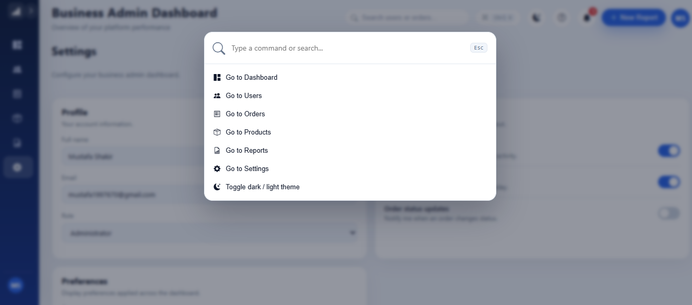
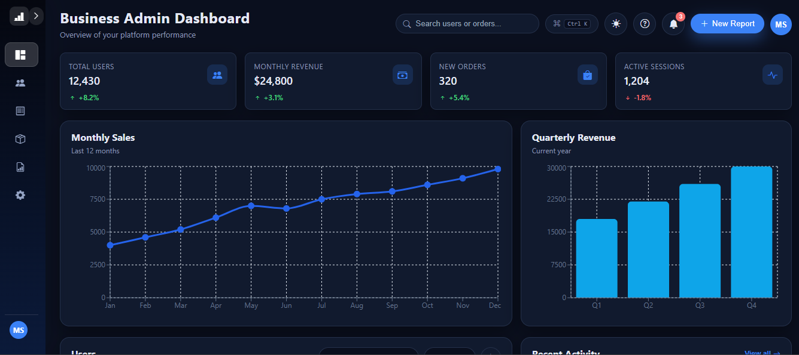
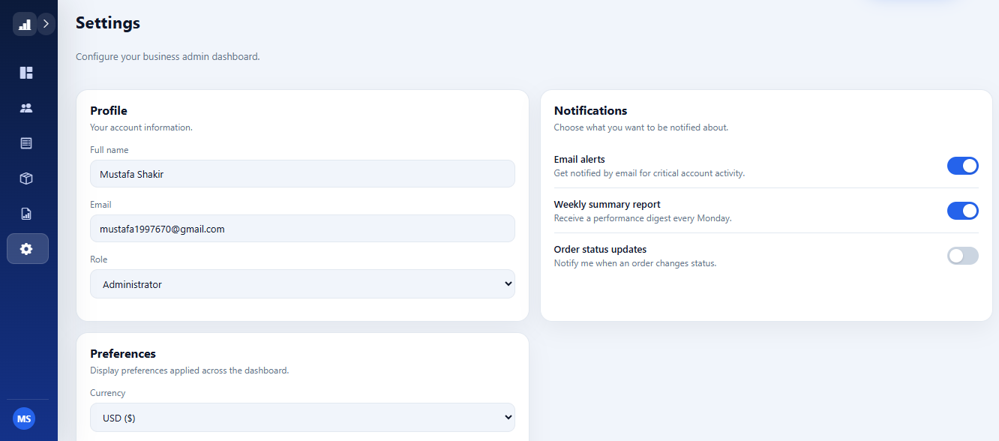

<div align="center">

# 📊 Business Admin Dashboard

**A fully interactive, enterprise-style admin dashboard built with React 19, Recharts, and Framer Motion.**

Analytics, user & order management, products, reports, and settings — every feature is real and interactive, not a visual placeholder.

[](https://mustafacoder365.github.io/Business-Admin-Dashboard/)


<br>



</div>

---

## ✨ Highlights

- ⌨️ **Command palette** (Ctrl / Cmd + K) for instant navigation and quick actions
- 🔍 **Global search** with keyboard navigation and match highlighting — jump straight to users or orders
- 📈 **Live-style analytics** — monthly sales and quarterly revenue charts
- 🗂️ **Data tables** — sorting, pagination, filtering, bulk actions, and **CSV export**
- 🧾 **Detail drawers** — click any order or user to open full details with a status timeline
- 🌗 **Dark / light theme** and **currency switcher**, persisted to localStorage
- 🎬 **Smooth animations** across cards, modals, and drawers
- 📱 **Fully responsive** — desktop, tablet, and mobile
- ⚡ **Route-based code splitting** for a lean initial bundle

## 📄 Pages

| Page | What it does |
|---|---|
| **Dashboard** | KPI cards, sales & revenue charts, sales by category, recent transactions, low-stock alerts, activity feed |
| **Users** | Sortable, paginated table with search, status filter, detail drawer, CSV export |
| **Orders** | Order table with status filter, detail drawer with status timeline, CSV export |
| **Products** | Catalog with category chips, stock levels, low / out-of-stock badges, "Add Product" form |
| **Reports** | Report history with type filter and a "New Report" generator |
| **Activity** | Full activity log with search, type filter, and pagination |
| **Settings** | Editable profile, notification toggles, theme and currency — all persisted |

Plus a **notifications center** (unread badge, mark-all-read), **profile menu**, **toast notifications**, **keyboard shortcuts help**, and a custom **404 page**.

## 📸 Screenshots

| Users | Orders |
|---|---|
|  |  |

| Products | Reports |
|---|---|
|  |  |

| Command Palette | Dark Mode |
|---|---|
|  |  |

| Settings | |
|---|---|
|  | |

## 🛠️ Tech Stack

| Area | Tools |
|---|---|
| **Framework** | [React 19](https://react.dev/) + [Vite](https://vitejs.dev/) |
| **Routing** | [React Router 7](https://reactrouter.com/) (HashRouter, GitHub Pages-ready) |
| **Charts** | [Recharts](https://recharts.org/) |
| **Animation** | [Framer Motion](https://motion.dev/) |
| **Icons** | [Bootstrap Icons](https://icons.getbootstrap.com/) |
| **State** | React Context — theme, currency, toasts |
| **Styling** | Modular CSS with a CSS-variable design system |
| **Data** | Mock API layer simulating async fetching |

## 📂 Project Structure

```
src/
├── api/          # Mock API (async data fetching)
├── components/   # Reusable UI: tables, charts, drawers, modals, command palette…
├── context/      # Theme, currency, and toast providers
├── data/         # Mock datasets
├── pages/        # Dashboard, Users, Orders, Products, Reports, Activity, Settings, 404
├── styles/       # Design tokens, layout, per-component styles
├── utils/        # CSV export, sortable-data hook
├── App.jsx
└── main.jsx
```

## 🚀 Getting Started

```bash
git clone https://github.com/MustafaCoder365/Business-Admin-Dashboard.git
cd Business-Admin-Dashboard
npm install
npm run dev
```

### Deploy to GitHub Pages

```bash
npm run deploy
```

## 👤 Author

**Mustafa Shakir** — Frontend Software Developer

[](https://github.com/MustafaCoder365)
[](https://www.linkedin.com/in/mustafa-shakir-840374330)
[](mailto:mustafa1997670@gmail.com)

⭐ If you like this project, give it a star!
